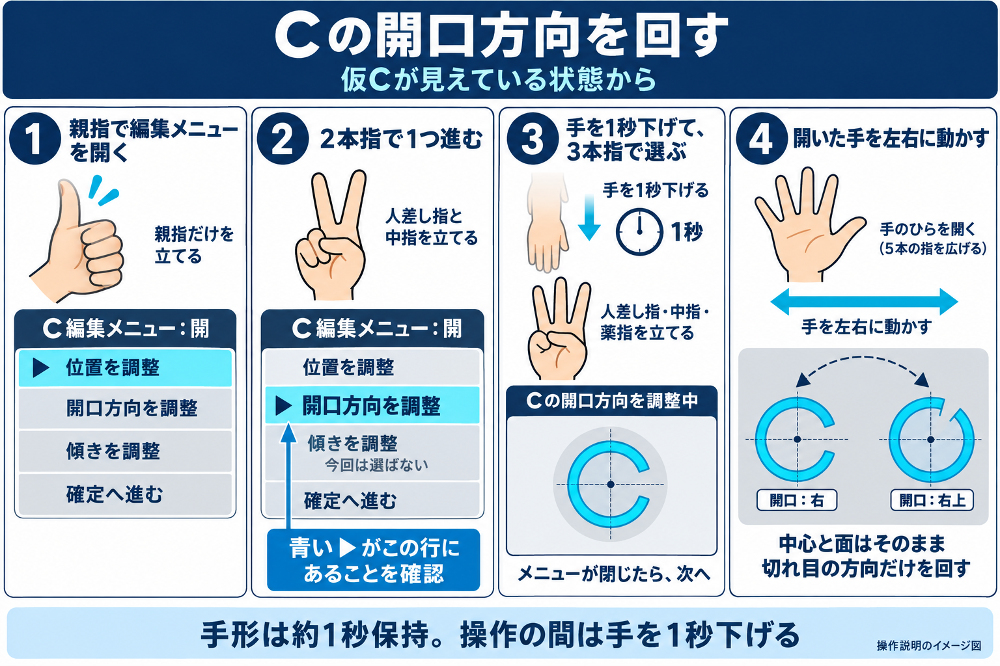
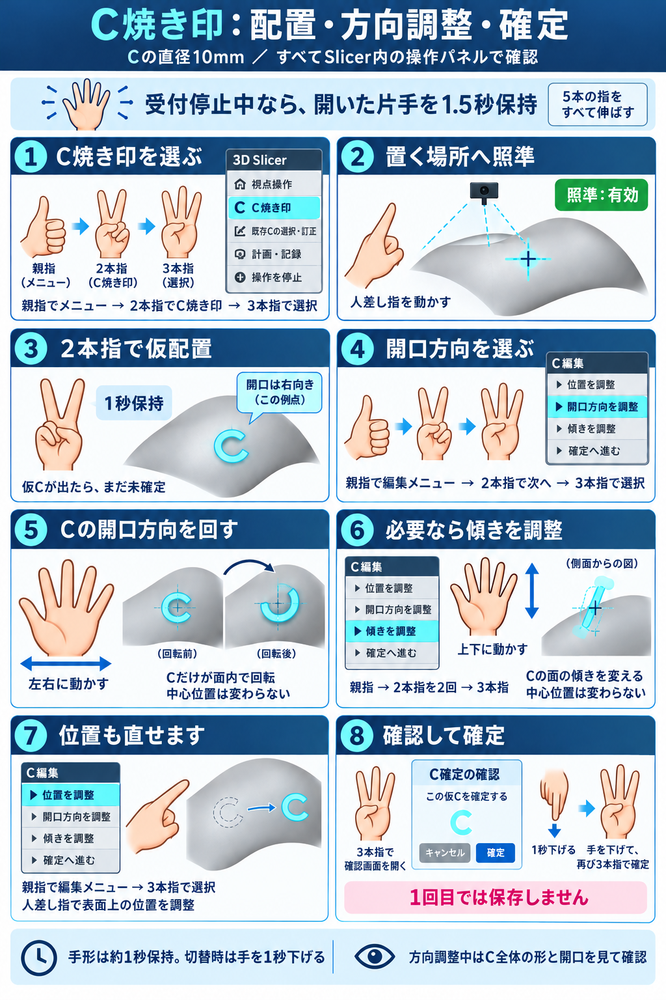
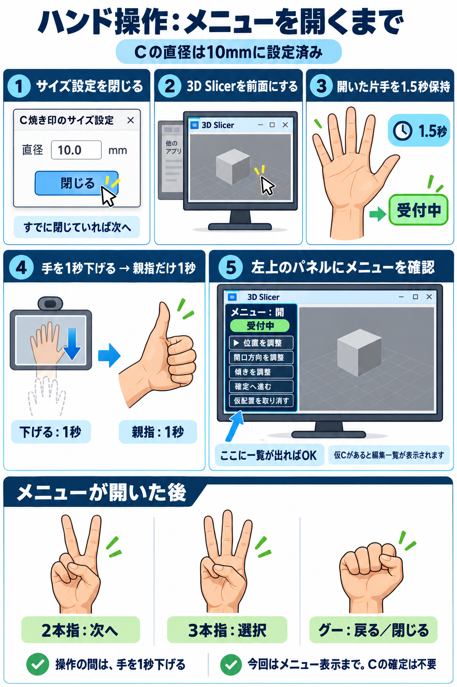
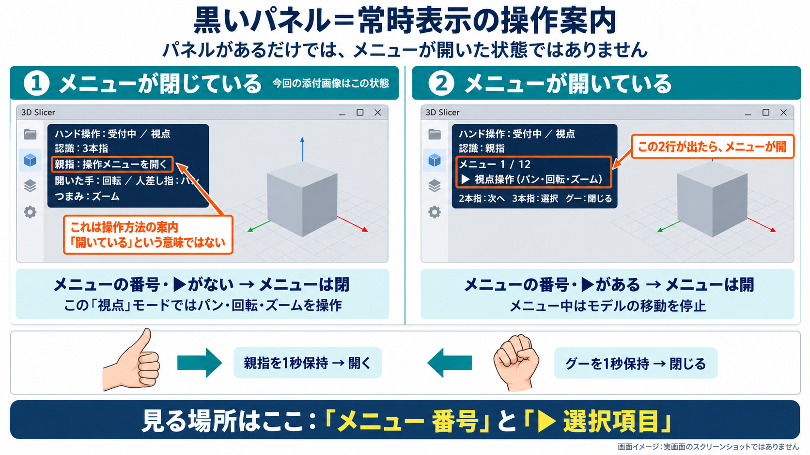
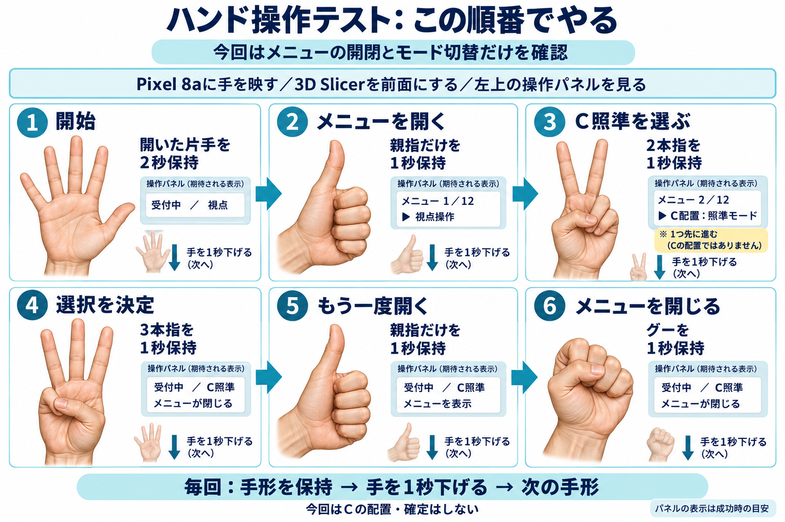

# 手で行うメニューテストの順番

## 修正版の現在状態・方向プレビュー（2026-10-10）

[修正報告書](34_hand-control-correction-report.md)。現在の操作名と仮C状態を常時表示し、同じドックでC全体の方向プレビューを確認できる。開始用の開いた手は1.5秒保持後、一度手を1秒下げるまでC／視点を動かさない。凍結時はメニューから編集再開を明示選択する。方向調整は「Cの開口方向を調整中」の表示を確認してから左右へ動かす。

## 開口方向だけを回す：仮Cが見えている場合（2026-10-10）

本人が仮Cを視認した後、縦回転のみと報告。調査時の実状態はmode=tiltだった。この図は「開口方向を調整」を選ぶ操作だけに絞る。親指で編集一覧を開く→2本指で1項目進む→青い▶が「開口方向を調整」にあることを確認→手を1秒下げて3本指で選ぶ→開いた手を左右へ。各操作の間は手を1秒下げる。図中の「Cの開口方向を調整中」は目的を示す説明表示で、現行UIの文字列を忠実に取得したものではない。

Cの中心と面を保って切れ目の方向を回す期待動作を示す。実手での成立は未検収。前の8手順図より、この症状には本図を優先する。[生成プロンプト](assets/hand-c-opening-direction-only-v1.prompt.md)。

## Cの配置・方向調整・確定（2026-10-10）

本人の「Cの方向も調整する必要がある。それも含めてイラストにして」に対応した説明図。現行の `hand_menu.py` の主一覧・編集一覧と `op_controller.py` の操作割当を照合した。実手の合格証拠ではない。

| 操作 | 選び方（編集メニューを開いた直後から） | 動かし方 |
|---|---|---|
| 開口方向 | 親指 → 2本指を1回 → 3本指 | 開いた手を左右へ。中心位置を保ち、Cの開口方向を面内で回す |
| 傾き | 親指 → 2本指を2回 → 3本指 | 開いた手を上下へ。Cの面を傾ける |
| 位置 | 親指 → 3本指 | 人差し指で表面上の位置を移す |

2本指を2回出す場合も、間に手を1秒下げる。メニューが開いている間は連続調整が止まるため、3本指で項目を選んでから手を動かす。主一覧の「視点操作」ではモデル全体を回すので、方向調整前にパネルのモードを確認する。図のCが最初に右へ開いているのは説明例で、現在の仮Cの方向を保証しない。直径10mmは設定例で、サイズ設定から変更できる。

仮Cが出た後は、3本指で確認画面を開き、手を1秒下げて再び3本指で確定する。1回目だけでは保存しない。図の編集一覧は今回使う先頭4項目を抜粋している。再接続で仮Cが凍結した場合は「凍結した仮Cの編集を再開」を明示選択してから調整する。グーはメニュー内では戻る／閉じる、メニュー外で仮Cがある場合は仮配置取消なので、方向調整の終了操作として使わない。

[生成プロンプト](assets/hand-c-placement-direction-guide-v1.prompt.md)。実手での方向調整・確定保存の検収とグー誤認識の再確認は未完了。既知の不合格は[実地結果](27_field-test-results.md)を維持する。

## 単一Slicer画面へ変更（2026-10-10）

最新UIは[統合UI計画・実装結果](31_unified-slicer-ui-plan.md)。左の固定ドックの「ハンド操作」タブだけを見て受付開始・メニュー操作する。カメラ確認とCサイズ設定も同じドック内へ移した。独立認識窓を前面にする手順は使わない。以下のイラストは手形・順序の説明として残すが、窓の構成は現行の固定ドックへ読み替える。

## 受付開始からメニュー表示まで（2026-10-10 最新手順図）

本人が提示した5手順をイラスト化した。設定画面が閉じていれば手順2から進める。Slicerを前面にし、開いた片手を1.5秒保持→手を1秒下げる→親指だけ1秒。左上のパネルで「メニュー：開」と▶を確認する。一覧は閉状態にも出るため、一覧があるだけでは開状態と判断しない。仮Cがある現在の例はC編集一覧。今回は確定不要。図は合成説明で、実画面の取得ではない。[生成プロンプト](assets/hand-menu-startup-guide-v1.prompt.md)。

## 最新UI（2026-10-10、画面案を実装）

現行版は[一覧型メニューの実装と画面](29_hand-menu-ui-implementation.md)を参照。主5項目とC編集の階層メニューへ変更済み。親指で開く、2本指で次へ、3本指で決定。グーで下位メニューから戻り、主メニューでは閉じる。確定は確認画面を挟む。再起動後は開いた片手1.5秒で受付開始。仮Cが凍結している場合は、親指で編集メニューを開き、2本指で「凍結した仮Cの編集を再開」へ進んで3本指で決定する。

以下の比較図・6手順は旧表示の記録であり、最新UIの選択順序・項目番号として使わない。

更新：パネルは選択中の1項目だけでなく、Slicerから取得した操作項目を一覧表示するよう変更した。「メニュー：開」のとき▶の行が選択対象。2本指で次の行、3本指で決定、グーで閉じる。「メニュー：閉」では一覧は案内表示で、親指で開いてから選択する。起動直後は未取得のため、受付開始後に親指で一覧を取得する。C照準項目の表示名は「C焼き印（照準・仮配置）」。X印・認印は利用者の表示例であり、機能や項目として追加していない。下の旧比較図は表示位置の説明用で、新しい一覧表示の実画面ではない。

2026-10-10。本人指示「テストストリーがわからない。やることをイラストにして」への操作ガイド。

## 先に確認：どれがメニューか

黒いパネルは常時表示の操作案内。パネルが見えるだけではメニューが開いたことにならない。

| 見る場所 | メニューが閉じている | メニューが開いている |
|---|---|---|
| パネル内の番号 | 「メニュー 1/12」等がない | 「メニュー 1/12」等がある |
| 選択項目 | 「▶ 選択項目」がない | 「▶ 視点操作」等がある |
| 「親指：操作メニューを開く」 | 親指で開くという操作案内。開状態の表示ではない | この案内の代わりにメニュー番号と選択項目が出る |
| 操作対象 | 現在のモード（視点／C照準等）の操作 | メニュー選択。モデルの連続操作は止まる |

親指を1秒保持すると開く。グーを1秒保持すると閉じる。メニューで項目を3本指で決定しても閉じる。現在の選択番号を見てから決定する。

本人の最新添付画像は「受付中／視点」で、メニュー番号・▶がなく、**メニューは閉じている状態**。実ログもmenu_confirm成功、menu=False、mode=view。以前の開状態の説明を最新画像へ当てはめない。

この比較図は合成の画面イメージであり実画面のスクリーンショットではない。[生成プロンプト](assets/hand-menu-screen-states-v1.prompt.md)。

## テストする順番

Pixel 8aに手を映し、3D Slicerを前面にして左上の操作パネルを見る。

1. 開いた片手を2秒保持：受付中／視点になる。
2. 親指だけを1秒保持：メニューが開く。
3. 2本指（人差し指・中指）を1秒保持：選択が「C配置：照準モード」へ1項目進む。
4. 3本指（人差し指・中指・薬指）を1秒保持：決定され、受付中／C照準になる。
5. 親指だけを1秒保持：メニューがもう一度開く。
6. グーを1秒保持：メニューが閉じ、C照準のままになる。

各段階の後に手を1秒下げてから次へ進む。図のパネルは**成功時の期待表示**であり、合格証拠ではない。選択が違う項目なら3本指で決定せず、その表示を報告する。

今回はメニュー開閉・選択・モード切替だけの確認。Cの配置・確定は行わない。既知の製品不合格と本試験の未完了箇所は[実地テスト結果](27_field-test-results.md)を維持する。

作成：組込みimage_gen。合成の手のイラストで、カメラ映像・患者情報は使用していない。[生成プロンプト](assets/hand-menu-test-story-v1.prompt.md)。
