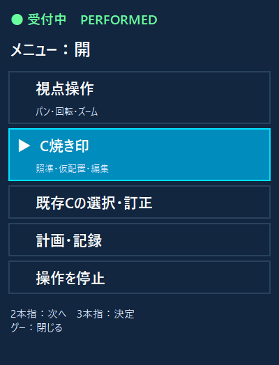
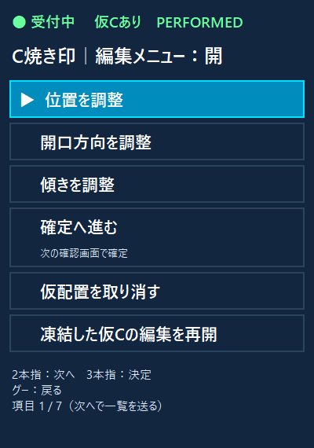
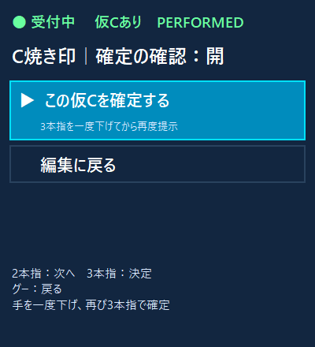

# 一覧型ハンド操作メニューの実装

2026-10-10。本人が指定した画面案 `assets/hand-menu-design-v1.png` と「このイメージ図で作って」を実装の根拠とする。原計画 docs/23「操作モードとジェスチャーの設計」の、手だけで選べるメニュー・選択先表示・メニュー中の連続操作停止に対応する。X印・認印は例えなので追加しない。

## 表示と操作

- 主メニュー：視点操作／C焼き印／既存Cの選択・訂正／計画・記録／操作停止。
- C焼き印を選ぶと照準モードへ。人差し指で有効表面に照準、2本指で仮配置。仮配置後の親指で編集メニューを開く。
- C編集：位置／開口方向／傾き／確定へ進む／取消。凍結からの編集再開と主メニューへ戻る経路も残す。
- 計画・記録：計画と実績の切替、作成、読込、スキップ、計画訂正の開始・保存・取消、計画外記録、記録読込、視点復元、理由選択、撤回、監査確認を既存の型付き操作へ接続。各操作の成立条件・既知不合格は元のサーバー実装に従う。
- 開状態：選択行を青い背景・枠・▶で表示。2本指で次へ、3本指で決定。グーは下位メニューから戻る、主メニューから閉じる。6項目を超える一覧は選択に合わせて表示範囲を切り替える。
- 閉状態：一覧は案内として表示し、▶は出さない。親指で開く。停止時も一覧を表示し、開いた片手1.5秒で開始。
- 確定へ進む選択／メニュー外の3本指では、確認画面だけを開き、保存要求を送らない。手を解放して再び3本指を提示したとき、確認時の仮C版を添えてcommitを送る。版不明・版変更なら送らない。グーで編集に戻れる。

## 実装範囲

`hand_menu.py`がローカルの階層・選択状態を管理し、`op_controller.py`が選択を既存の型付きコマンドへ変換。`slicer_hud.py`がカード表示を描画。実アプリは `panel_menu=True` を指定する。旧サーバーのmenu_next/menu_confirmで画面一覧を動かす方式から、パネルで選択して対象操作を送る方式へ変更した。サーバーの受付・前面・状態・保存条件は保持し、任意Pythonやキー送信経路は追加しない。Slicer本体を再起動せず適用可能。

旧モジュールのDRAFTメニュー例外は、この新しい手操作経路では当該メソッドを呼ばない。Slicer側の旧UI・元の不具合が修正反映済みとは扱わない。

## 確認したこと

自己検証79件合格。主メニューから照準への接続、編集から方向モードへの接続、独立した2回目の3本指による確定、版変更拒否、通信断の確認状態破棄、拒否時のメニュー保持、計画階層と停止への接続を含む。

以下は実装したTkウィジェットに合成状態を与えた描画確認。実手でこの操作が成立した証拠ではない。患者モデルやカメラ画像は取得していない。

稼働アプリを再起動して反映した。実ログではPixel入力の手形認識が継続し、受付停止・仮Cありを確認。自作HUDウィンドウだけの実表示取得で、新しい編集一覧と停止表示を確認した。新UIの実手での選択・配置・確定は未検収。再起動による仮Cの凍結は、編集メニューの「凍結した仮Cの編集を再開」で明示解除する。既知の保存・監査等の不合格はdocs/27に残す。
