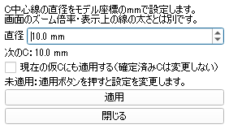

# C焼き印のサイズ設定

2026-10-10。本人の追加要求「Cのサイズを設定するメニューが必要」「10ｍｍ」「変更できるように設計しろよ。ここはハンドモーションでする必要なし」を根拠とする。10mmは直径として扱う。

## 設定UI

2026-10-10更新：現行は[単一Slicer UI](31_unified-slicer-ui-plan.md)の「Cの直径設定（mm）を開く」から、同じドック内へ設定欄を展開する。独立ウィンドウは使用しない。以下の旧ダイアログ画像は寸法設定の過去の証跡として残す。

黒いハンド操作パネル下部の、マウス用「C焼き印のサイズ設定（mm）」ボタンからSlicer内の設定ダイアログを開く。Slicerの専用操作ウィジェットにも同じボタンを設ける。ハンドジェスチャーの割当ては追加しない。

| 項目 | 表示・動作 |
|---|---|
| 直径 | 数値入力。初期値10.0mm、0.5mm刻み。直接入力も可能 |
| 次のC | 現在設定されている直径を表示 |
| 現在の仮Cにも適用 | 明示チェックした場合だけ現在の仮Cも変更。既定は未チェック |
| 仮Cの編集再開 | 凍結中だけ表示。操作者がクリックして明示再開する |
| 適用 | 入力値を検証して変更。入力中は形状を変えない |
| 閉じる | 未適用の入力は反映しない |

設定対象はC中心線の円の直径。線の表示上の太さや画面のピクセル寸法とは区別する。モデル座標をmmとして扱うため、元モデルのスケールが正しいことは別途確認が必要。画面上で定規を当てて10mmになるという意味ではない。

入力範囲0.1〜200mmは非臨床プロトタイプの数値制限であり、治療上の推奨値ではない。非数・無限大・負値・範囲外・型違いは変更しない。

## 形状・保存への反映

従来の初期テンプレートは半径10（中心線直径20）。Slicerアプリの新しい初期テンプレートは半径5（直径10mm）。既存テンプレートライブラリー自体の既定値は、旧イベントと試験の互換性のため維持する。

次のCの寸法と、現在の仮Cのテンプレートを分けて保持する。「次のCのみ」では現在の仮Cを変えない。現在の仮Cを変更するときもアンカー位置・方向・draft_idは維持し、版を増やして古い確認版の確定を拒否できるようにする。凍結を自動解除しない。

新しい確定イベントにテンプレート定義・直径・mm単位・形状点を記録する。再読込は保存された形状点を使い、現在のサイズ設定で昔のCを作り直さない。確定済みCの台帳を上書きしない。

## 検証と稼働反映

追加是正：本人の閉じないという報告後、実Slicerで `close()` にclicked(bool)のFalseが渡されるValueErrorを確認。閉じるボタンをPython関数経由に修正し、既存セッションへUIだけ再読込。実Qtシグナル自己検証で閉鎖・寸法と仮C版の不変を確認し、別途実マウスクリックでもダイアログ消失を確認した。証拠はwork/size-dialog-close-check.jsonと実画面観測。従来の適用確認では閉じるボタンを検収していなかったため、この不具合を見落としていた。

Slicer側自己検証143件合格。次のC設定変更で既存仮Cを変えないこと、仮Cサイズ変更時の位置・方向維持と版更新、不正値の無作用、凍結中の拒否を含む。構文チェック合格。

稼働反映完了。本人の「進めて」を受け、既存セッションへ `work/apply_size_settings_live.py` をSlicer標準のスクリプト実行ダイアログから適用した。コンソールへの初回入力は残っていた空白でIndentationErrorとなり、変更処理が実行されなかったことを確認してから、ファイル実行へ切り替えた。シーン再読込・Slicer再起動・台帳書込は行っていない。

実設定画面で直径10.0mmを確認し、マウス操作で凍結した仮Cの編集再開、現在の仮Cへの適用チェック、適用を実行。「適用しました：直径10.0mm／現在の仮C＋次のC」を実画面のテキストで確認した。`work/size-settings-live-result.json`では次のCと現在仮Cがともに10mm、仮Cの33点の中心からの距離は約5mm、仮C版1を確認。これらは実ツールでの設定・仮C形状の成立であり、ハンド操作や記録保存の通し合格ではない。

認識アプリは署名付きrun.ps1から再起動してパネル下部にマウス用設定ボタンを反映。確認画面に進む際には同じ接続でstatusを照会して、マウスによるサイズ編集後の版を取得するように変更し、認識側自己検証79件合格。Slicer側の操作ウィジェットにも設定ボタンを追加した。パネルのボタンからダイアログを再度開く実クリックは未検収だが、ダイアログ内の設定適用は実クリックで検収済み。

画面は「サイズ設定」ダイアログのみを取得したもの。モデルの画像やカメラ映像はこの成果物に含めない。元モデルの寸法校正や表示線の実太さ、C確定・保存に関する既知不合格は本変更で解消したとは扱わない。

Slicer公式のコンソール表示ショートカットは[ユーザーインターフェース文書](https://slicer.readthedocs.io/en/latest/user_guide/user_interface.html)で確認した。コンソールを開くこと自体はサイズ変更やスクリプト実行の成功ではない。
