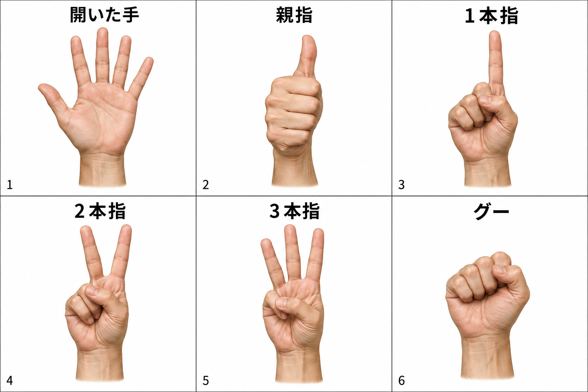

# ハンドジェスチャーのイラストを使った認識・操作経路テスト

実施日：2026-10-10。本人指示「お前がハンドジェスチャーのイラストを作ってテストしろよ」への結果。

## 追試：実Slicerでの操作・描画確認

本人の「やれや」を受け既存3D Slicer 5.12.3で追試。Computer UseとSlicer標準のスクリプトファイル実行を使用した。実モデルが合成画像から推定したShape・ランドマークをSlicer内の現行OperationControllerへ再生し、send先を既存の実CommandDispatcher.dispatch_localへ接続。受付・モード・仮C・前面条件を通し、実op_rotate_openingと実MRML描画を実行した。テスト用の新規TCP接続は作らない。既存認識アプリはタイムアウト後に自動再接続した。

**追試判定：一部成立、全体は不合格。** 以下は実ツール観測を含む自己検証で、独立レビューや実手の合格ではない。

- 既存仮Cを保持し、停止状態から画像由来の開いた手で受付開始。凍結済み仮Cはresume_draftを明示実行。
- 画像由来の親指→2本指→3本指で、編集一覧のrotate選択・実サーバーmode=rotateへ到達。
- rotate_opening受付成功40回、拒否2回。既存モードがrotateだったため、開始用の開いた手を保持する後半にも推定点の揺れから回転命令が出た。40回は左右移動区間だけの件数ではない。tilt命令は送っていない。
- 実Cの開口角は約39.98度変化。実仮CのID・中心anchor・面normal・基底u/vは不変。実MRML33点が変化し、実画面に水色のC曲線が描画されていることを目視。
- 一時的にカメラを仮Cの面に正対・拡大し視認性確認。Cの一部がモデルに隠れており、全体の開口方向を確認しづらい。完全なCが常に見えるとは判定しない。
- 同期再生中に認識接続のタイムアウト／自動再接続と凍結が発生。2命令は「draft is frozen after recognition loss」で拒否。Slicerコンソールに接続処理のValueErrorも観測。同期再生によるイベント処理占有が関与した可能性はあるが、原因は未確定。長時間同期実行は通常カメラ経路の代表ではない。
- 実ディスパッチ経由の逆回転で元の開口角へ戻し、カメラ位置・注視点・上方向・投影方法・縮尺・ラベル設定を復元。restored=true、stopped_after_test=trueを確認。復元でも仮C版は進み、最終revision=368。版を過去へ戻さない。通常画面へ戻したことも目視した。

実Slicerのローカル受付・MRML更新・描画は検収した。実Pixelで本人の手を映す経路、TCPの封筒・重複抑止・時刻条件、本人の縦回転症状の解消、全手形と確定保存は未検収。下記の初回オフライン試験の「実Slicer未検収」は初回時点の記録として読む。

証跡：[実Slicer追試JSON](../work/illustrated-gesture-live-slicer-result.json)、[実行スクリプト](../work/test_illustrated_gestures_in_slicer.py)、[復元スクリプト](../work/restore_illustrated_gesture_slicer.py)、[モデル推定の再生入力](../work/illustrated-gesture-replay-input.json)。カメラ／CT画像をファイルへ保存せず、確定・取消・台帳保存・シーン保存は実行しない。

## 結果

**総合：一部不合格。** 合成画像から実モデルの判定を通して1本指→2本指の仮配置と、開口方向の選択・左右移動命令を自己検証した。親指にUNKNOWN、グーにPINCHが混じったため、全手形安定合格とはしない。

## 試験方法と対象

- 画像：組込みimage_genで生成した6手形。人間が見て意図した形を期待値とし、期待値をモデルへ入力しない。実カメラ画像・患者情報を使用しない。
- 推論：プロジェクトにある `models/hand_landmarker.task` と現行 `TasksHandRecognizer` を実行。VIDEOモード、最大2手、検出／追跡閾値0.65、現行 `classify_shape` のつまみ閾値0.055・親指比0.45。
- 各セルをメモリ内で抽出し、原画像と左右反転の2条件を各30フレーム反復。12条件・360フレーム。各条件は認識器を新規作成。画像サイズは1536×1024、1セル512×512。カメラ入力1280×720とは異なる。
- 同じ静止画の反復なので360枚の独立した手形サンプルではない。実手精度の推定値や手の切替途中の認識試験には使わない。
- 操作経路：推論で得たShapeとランドマークを現行 `OperationController` へ入力。左右反転条件を採用し、各手形の間は手なし1秒。Slicer接続だけは自作RecordingClientで記録する。実サーバーへは接続せず、実仮C・シーン・台帳を変更しない。

## 手形の認識結果

| 期待手形 | 原画像30フレーム | 左右反転30フレーム | 全フレーム一致 |
|---|---|---|---|
| 開いた手 | OPEN_PALM 30 | OPEN_PALM 30 | 両条件合格 |
| 親指 | THUMB 25、UNKNOWN 5 | THUMB 28、UNKNOWN 2 | 両条件不合格 |
| 1本指 | POINT 30 | POINT 30 | 両条件合格 |
| 2本指 | TWO 30 | TWO 30 | 両条件合格 |
| 3本指 | THREE 30 | THREE 30 | 両条件合格 |
| グー | FIST 29、PINCH 1 | FIST 30 | 原画像不合格 |

全フレーム一致は9/12条件。親指のUNKNOWNは無作用として扱った。今回グー→THUMBは出なかったが、本人の実手で解消した証拠ではない。グー→PINCHは親指と人差し指の近接を優先判定する経路の誤判定として残す。数値閾値をこのイラストへ合わせて変更しない。

## 画像判定を使った操作経路の自己検証

| 入力 | 実コントローラーでの結果（記録用模擬接続） |
|---|---|
| 開いた手を3秒 | armが1回 |
| 親指 | 主メニューを開く |
| 2本指 | C焼き印の行へ1項目進む |
| 3本指 | select_mode:aimが1回、メニューを閉じる |
| 1本指 | 照準aimを送る |
| 2本指 | stampが1回、仮Cあり状態へ |
| 親指 | C編集メニュー、位置調整の行から開始 |
| 2本指 | 開口方向rotateの行へ1項目進む |
| 3本指 | select_mode:rotateが1回。tiltを選ばない |

この模擬接続は照準の表面交差判定・プロトコル安全条件・実描画を検証しない。「仮配置成立」ではなく、認識判定からstamp命令が出る経路の検証。

## 左右移動とC形状の自己検証

開いた手のセルを画像上で右へ0〜50px移動させ、40フレームを再推論した。ランドマークを手作業で作ったり移動させたりせず、移動した画像からモデルが推定した点を使用した。

- OPEN_PALM：40/40。
- 命令：rotate_opening 26回。tilt 0回。合計開口回転量約40.68度。
- その画像由来の合計角度を現行 `CStampController.rotate_opening` に適用。中心anchor・面normal・基底u/vが不変、in_plane_angleだけ変化したことを確認。これはローカル形状処理で、Slicerレンダリングの検査ではない。

## 証跡と未実施

[推論・操作・形状の生結果JSON](../work/illustrated-gesture-test-results.json)、[画像認識と操作の再実行スクリプト](../work/test_illustrated_gestures.py)、[形状確認スクリプト](../work/check_illustrated_rotation_geometry.py)、[生成プロンプト](assets/hand-gesture-recognition-test-v1.prompt.md)。入力画像・モデルのSHA-256と設定値はJSONに記録した。

実Pixelの照明・角度・握り方、実手の1本→2本切替、実Slicerの受信・描画・縦回転症状の解消、確定保存、継続運用は未検収。元の実地不合格は[実地テスト結果](27_field-test-results.md)を維持する。次の確認対象は、実UIで「開口方向」が選ばれたことと、その状態で面内回転が見えること。
