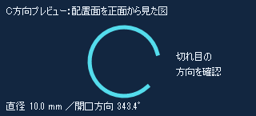

# ハンド操作・C方向調整の修正報告書

作成日：2026-10-10  
対象計画：[修正計画書 第1版](33_hand-control-correction-plan.md)  
現在の判定（2026-10-11）：**実装未完了。** [計画全項目の実装照合](37_implementation-plan-audit.md)で操作入口・安全処理・表示済み確定・計画／保存／監査の不足を確認。残りは検収だけではない。以下は2026-10-10に実装・限定反映した内容とその時点の証跡。最新テストは[docs/36](36_corrected-hand-control-test-results.md)。

## 1. 修正内容

本人の「縦回転しかしない」「1本から2本が反応しない」「説明が悪い」「グーが親指と認識される」と、docs/32の実Slicer追試を根拠に修正した。原要求のFR-008/009/013、OP-006/007、AC-002/011、SR-001/006に結び付ける。

| 計画 | 実装した修正 | 変更箇所 |
|---|---|---|
| A 接続 | 新しいソケットを有効集合へ登録してから旧ソケットを切断。dropを二重呼出し可能にし、旧ソケットの遅延dropが新しい接続を停止させない。最後の接続喪失は停止・凍結を維持 | CStampModule.py の_CommandServer |
| A 描画・試験 | 33点のMRML更新をStartModify/EndModifyでまとめる。GUI内の一括同期再生をやめ、別プロセスから50ms間隔で実TCP送信。通常認識アプリは試験前に停止して入力を分離 | _update_draft_curve、work/test_corrected_live_tcp.py |
| B 開始 | arm成功後は操作準備状態。実際に手がない状態を保持するまで連続・離散操作を抑止。認識不能だが手が存在する場合は手下げと判定しない | op_controller.py、app.py |
| B 連続入力 | rotate/tiltは開いた手だけ、照準・位置は1本指だけで動く。不明形は無作用。方向調整にデッドゾーンを設け、ゆっくりした動きは累積して受け付ける | op_controller.py |
| C 状態・案内 | 現在のモード、仮Cの有無、開始準備・凍結を常時表示。開口方向は左右、傾きは上下と区別。仮配置済みTWOの無作用理由、照準有効、戻り・選択の案内を状態別に表示 | ui_bridge.py、unified_hand_panel.py |
| D 方向表示 | 同じドックに実仮Cのテンプレート・面内角からC全体を描く方向プレビューを追加。直径mmと開口方向角を表示。3Dの仮Cラベルを非表示にして切れ目を覆わないよう整理 | direction_preview.py、unified_hand_panel.py、CStampModule.py |
| E 認識 | 伸びた指を画面のy方向で判定せず、各指のMCP→PIP関節軸と先端位置で判定。グーの先端接触をつまみにしない。握りとつまみの区別が曖昧な場合はUNKNOWNとして取消を防ぐ。欠損・非有限・退化座標は無作用 | gesture_fsm.py |
| F 試験 | 実モデル推定の合成画像を実OperationController→実SlicerSessionClient→実CommandDispatcher→MRMLへ再生。実接続置換試験も用意。終了時に方向を逆操作で復元し停止 | work/の試験スクリプト、docs/27/28/32/33/34 |

Cの世界座標・面・直径を見た目に合わせて変える修正はしていない。方向プレビューは「配置面を正面から見た図」と表示し、3D上の解剖学的位置を示す画像とは区別する。3Dモデルによる遮蔽そのものは残るが、C全体の切れ目を同じドックで確認できる。通常マウス代替とサイズ数値入力は維持する。

## 2. 実UIの表示

この画像は合成説明図ではなく、実Slicerの方向プレビューQLabelだけを取得したもの。患者・モデル・カメラ画像は含まない。実画面では、モード見出し「Cの開口方向を調整中」と「開いた手を左右へ」の案内も確認した。

開始は開いた片手1.5秒→手を1秒下げる。仮Cが凍結している場合は親指でC編集を開き「凍結した仮Cの編集を再開」を選ぶ。方向調整は親指→青い▶を「開口方向を調整」に合わせる→3本指で選択→開いた手を左右へ。各手形の間は手を1秒下げる。メニューが開いている間は連続調整しない。

## 3. 検証結果

自作入力・試験コードによる検査は自己検証と表示する。実TCPと実UIの観測を含んでも、本人の実手操作や独立レビューを実施したことにはならない。

| 検査段階 | 結果 | 限界 |
|---|---|---|
| 認識・制御の自己検証 | 111件合格。開始後保持で動かない3モード、不明形・他手形の方向調整拒否、指の回転方向、グー接触、曖昧なつまみ、実手不在と認識不能の区別、低速移動を含む | 自作ランドマーク・模擬接続を含む |
| Slicer側自己検証 | 146件合格。接続の再入・遅延drop・close、方向プレビューの実寸・角度・非変更を追加 | Qtソケットの再入試験は自作模擬信号。実接続は別行で検収 |
| 同じ合成画像での実モデル推論 | 修正前9/12条件→修正後12/12条件が全フレーム一致。6手形×原画像／左右反転×30フレーム | 同じ静止画の反復。実手・距離・照明条件の精度測定ではない |
| 最終判定ルールの再確認 | 保存した実モデル推定点に最終分類規則を適用し、採用する左右反転6形各30フレーム一致 | 追加した曖昧接触保護は推定点の再分類。実モデルを別の手形で再評価したものではない |
| 実TCP・実Slicer | 段階画像再生でrotate選択、開口回転と逆回転による復元。予期しない拒否0、タイムアウト0、凍結拒否0。台帳／シーン保存なし | 短時間試験。全手形・実Pixelの手・10分の連続動作は未検収 |
| 実接続置換 | 10回すべて新接続でstatus成功、停止状態を維持 | 10回の接続置換。すべてのタイムアウト原因が解消した証拠ではない |
| 実画面・幾何 | プレビューPixmapあり、元の中心・法線・方向を保持／復元。表示更新で位置・版不変。次／現在の直径とも10mm | 3D遮蔽の解消ではなく方向確認の補助表示。すべての側面・曲面での検収は未実施 |
| 稼働反映 | Slicerを再起動・シーン再読込せずUI・接続・描画メソッドを限定反映。Pixel 8aの認識アプリを通常の署名付きrun.ps1で再起動 | 新規Slicer起動からの全経路再試験は未実施 |

構文検査と対象差分の空白検査も合格。検出／追跡閾値0.65、認識モデル、入力解像度1280×720、前面ゲート、TTL、版束縛、独立した確定、再接続後の明示再開は維持した。安全条件を緩めて合格させていない。

## 4. 証跡

- [修正後の画像認識結果](../work/illustrated-gesture-test-after-correction.json)、[修正前の記録](../work/illustrated-gesture-test-before-correction.json)。修正前のdocs/32参照結果は保持した。
- [実TCPの命令・応答と復元結果](../work/corrected-live-tcp-result.json)、[実行スクリプト](../work/test_corrected_live_tcp.py)。req/seq/ts/sessionを持つ実クライアント経由で実行。
- [実接続置換10回](../work/corrected-connections-result.json)、[接続試験スクリプト](../work/test_corrected_connections.py)。
- [UI・接続の限定反映結果](../work/correction-ui-live-result.json)、[表示・元形状・寸法の検収](../work/correction-display-live-result.json)。
- [最新の認識起動情報](../work/recognition-current-launch.json)。カメラ確認はファイル保存せず、ログは手形・信頼度・処理時間などのメタデータだけ。

一度目のUI設置結果のdirection_pixmap_present=falseは認識アプリ未接続時の非表示。接続後の実画面と最終表示検収ではtrue。未接続時の非表示を方向表示不成立と混同しない。

## 5. 残る検収と完了状態

計画A〜Eの主要実装とFの実TCP試験を行ったが、docs/33のV-01〜10すべてを規定回数・全条件で実施したわけではない。以下は未完了として維持する。

- 本人の実Pixel入力でグー→親指、1本→2本、開口方向の選択、面内回転が成立し、縦回転報告が解消したことの検収。
- 距離・傾き・照明・左右・切替途中の実手試験と、通常操作／段階画像再生各10分の継続試験。
- すべてのカメラ角度・モデル曲率での方向プレビューと3D表示の対応、新規起動からの操作。
- 独立確定・取消・保存失敗・再接続を含む全体通し試験。docs/27のF-01〜09は本修正だけで閉じない。

既存仮Cは保持し、試験後は受付停止・凍結状態へ戻す。確定・取消・台帳追記・シーン保存は今回実行していない。次の検収は、単一Slicerドックを見ながら本人の実手で開始・手下げ・編集再開・開口方向選択・左右移動・グー戻りを確認すること。
