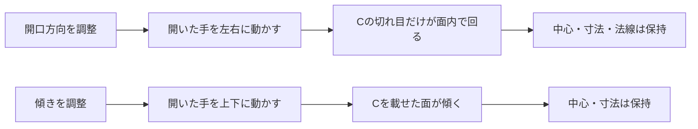
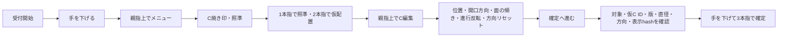

# 今回の操作入口と確認事項

2026-10-12更新。docs/38に対応。非臨床のデモ用。実装状態・稼働反映はdocs/39を参照。本人指定の親指上＝選択を上、親指下＝下、基準直径5mmを現行案内とする。

2026-10-11 SOL実装追記：対象登録・実効構成の照合を追加した。認識表示だけでは受付状態を判断せず、同じSlicerのパネル上部にある接続／停止／拒否理由を見る。

## パネルの見方


図のメニューは説明用の抜粋。実際の主メニューは「視点操作」「C焼き印」「既存Cの選択・訂正」「計画・記録」「操作を停止」の5項目。旧10mmの模式図は現行手順には使用しない。


```text
ハンド操作                  詳細マウス操作
受付中｜認識アプリ接続       ← 停止中なら編集は受け付けない
現在の操作：開口方向を調整   ← 「傾きを調整」と区別する
メニュー：開                ← 親指上で開いたことをここで確認
  位置を調整
▶ 開口方向を調整            ← 親指上／下で▶を上下、3本指で選択
  傾きを調整
  進行方向を反転
  方向を初期状態に戻す
  確定へ進む                ← 次の確認画面だけでは保存されない
```

行名は`hand_menu.py`のEDITと一致する抜粋。これは読み方の模式図で、実手試験の画面証跡ではない。「メニュー：閉」の状態にも項目の概要は表示される。**選択中の▶と「メニュー：開」がある状態で上下・選択する。** 認識欄が変わっても「停止中」なら操作は受け付けない。

グーは確認画面→C編集→主メニュー→閉じる、の順に一段ずつ戻る。各段階で手を下げてから出し直す。計画・記録の選択一覧からは「計画・記録」へ戻る。グーの保持だけで複数階層を戻ったり仮Cを取り消したりしない。**メニューが閉じた状態で仮Cがあるとき、新しくグーを提示すると仮Cの取消になる。** 閉じるだけなら「メニュー：閉」で止める。



## ハンド操作

| 手形・動作 | 操作 | 見る場所 |
|---|---|---|
| 開いた片手を1.5秒保持 | 受付開始。その後一度手を下げる | 同じSlicer内の「受付中・操作準備」表示 |
| 親指上を保持（手首は画面の横側） | 閉じたメニューを開く | 固定ハンド操作パネルの「メニュー：開」と選択中の▶ |
| メニュー内で親指上／親指下 | ▶を1項目上／下へ | 先頭で上は末尾へ、末尾で下は先頭へ循環 |
| 3本指（人差し指・中指・薬指） | 選択項目を実行 | モード／理由／拒否表示。ILoveYouとは別の手形 |
| メニュー内でグー | 前のメニューへ戻る／主メニューを閉じる | メニューの見出しと開閉表示 |
| 照準モードで人差し指1本→2本指 | 表面照準→仮C配置 | 照準が有効で、仮Cあり・未確定 |
| 開口方向モードで開いた手を左右 | Cの切れ目を面内で回す | 開口方向の図と実C。面の法線は保持 |
| 傾きモードで開いた手を上下 | Cの面を傾ける | 面の向き。開口方向とは別操作 |
| 位置調整モードで人差し指 | 表面上で仮Cを移動 | 仮Cの中心 |

各離散操作は手形を約0.5秒保持し、操作の間は手を1秒下げる。これは操作を区切るための案内時間で、実装の保持・解除判定は既定0.35秒。開始だけは1.5秒。開いた手・人差し指・Vサイン・グーは手首を画面の下側、親指上下は手首を横側に向ける。これは本人が安定を確認した提示条件で、全角度の認識保証ではない。

2本指はメニュー内では従来どおり下への移動もできるが、通常の案内は親指上下に統一する。メニュー外の親指下とILoveYouには操作を割り当てていない。認識不能で編集を凍結した場合は、受付停止中なら開いた片手で再開始して一度手を下げ、C編集の「凍結した仮Cの編集を再開」を選ぶ。自然に手が再認識されても編集は再開しない。

モード変更や記録操作が受理されるとメニューは閉じる。次のメニュー操作には、手を下げて親指上で再び開く。「計画・記録」の操作を続ける場合も、主メニューから入り直す。



Cの基準直径は**5mm**。サイズは準備用のサイズ設定からマウスで変更できる。現在の仮Cにも適用する場合は、その選択を明示する。寸法を変更した仮Cでは表示の版も変わるため、以前開いた確定確認は使えない。確定済みのCは変更しない。

| 確認する段階 | 手の提示・区切り | 期待する表示・作用 | 動かない場合に見る表示 |
|---|---|---|---|
| 受付を始める | 開いた片手1.5秒→手を1秒下げる | 「受付中」。開始だけではCは動かない | 接続、開始保持、停止理由、構成不一致 |
| メニューを開く | 親指上を保持→手を下げる | 「メニュー：開」または「C編集メニュー：開」と選択中の▶ | 停止中、認識された手形、保持不足 |
| 項目を選ぶ | 親指上／下で▶を上下。下げて3本指 | 選択したモード名に変わり、メニューが閉じる | メニュー閉、凍結、無作用理由 |
| 仮Cを置く | 照準モードで1本指→下げて2本指 | 有効な表面上に仮C。未確定 | 照準無効、表面外、対象不一致 |
| 方向を調整する | 開口方向を選択→開いた手を左右 | 切れ目が面内で回る。中心・寸法不変 | 現在モードが傾きになっていないか、凍結理由 |
| 確定確認を開く | 「確定へ進む」を選択 | ID・版・寸法・方向・hashを表示。保存0 | 未描画、対象変更、版変更 |
| 確定する | 確認後に手を下げ、3本指を新しく提示 | 保存成功の表示と記録1件 | 保存失敗・拒否理由。失敗時は未確定 |
| 戻る | 手を下げ、グーを提示 | 一段戻る。主メニューなら閉じる | 認識がグーか親指か、現在のメニュー階層 |

## 計画・記録メニュー

登録計画、作成者、保存先、予定項目、理由は一覧から選択する。計画の訂正は、訂正開始→予定項目を選択→Cを仮編集→表示確認→確定→理由を選択→計画訂正を保存。元の計画版は残る。未保存の訂正を取り消す入口もある。

削除・撤回は、対象を選択→理由を選択→削除／撤回を要求→パネルの監査確認待ちに対象と理由が表示→一度手を下げる→「監査確認」を選択、の順。元の操作記録は書き換えない。

計画項目の追加・移動・実施順変更、予定のスキップ、保存状態確認、直前の確定要求の結果照会も「計画・記録」にある。対象・計画版を変更した場合は理由を選び直す。確定結果の照会は記録を追加しない。

### 保存版を比較する

「計画・記録」→「登録計画を選ぶ」で対象を選び、メニューを開き直して「計画・記録」→「保存された計画版を比較」へ進む。親指上／下で「第1版」「第2版」などへ▶を合わせ、手を下げて3本指で決定する。パネルに選択版／最新保存版・hash・追加／削除／位置変更／方向変更の数を表示する。再び「計画・記録」→「計画を読み込む」でその版の予定Cを表示できる。

旧版には「比較専用・編集不可」と表示される。旧版を編集したり、そのまま記録操作へ使ったりできない。最新保存版を明示選択してから「計画の訂正を開始」へ進む。未保存の訂正がある間は版比較を拒否するため、訂正を保存するか、明示的に取り消す。過去版を選ぶ操作で元台帳や過去のCは変更しない。

旧形式・破損した計画台帳は拒否理由を表示する。自動変換・自動署名はしない。準備時の「計画版台帳」欄で検証可能な保存先を指定する。

「新規計画台帳を準備（既存履歴は保持）」は、新しい空の保存先を作る。受付停止・仮Cなしの準備状態だけで使える。現在の仮Cがある場合は無効であり、その仮Cを勝手に取消しない。既存ファイル名を指定しても上書きしない。

### 次回起動にも保存先を使う

準備用のマウス画面で「台帳(JSONL)」「計画版台帳」を指定し、**「台帳保存先を保存（次回起動にも適用）」**を押す。「保存しました。次回起動もこの台帳を使用します。」を確認する。受付停止・仮Cなしに加え、未保存の計画訂正・監査確認がない状態で行う。入力欄を変更しただけでは永続保存にならない。現在のCや計画が残っている場合は、自分の意図に従って確定・取消・監査確認を完了してから切り替える。

登録した保存先が消失・破損した場合は操作を拒否し、準備画面へ再指定を案内する。旧保存先へ勝手には戻らない。以前の台帳のファイル内容を移行・修復する機能ではない。

対象登録・実効構成の準備欄も操作中は変更できない。登録対象、カメラ、保持時間、感度、モデル、ロードしたソースが準備した構成と違う場合は停止・凍結する。以前の接続を再利用して受付を再開できない。構成を正しく準備し直してから、明示開始する。

## カメラが使えない場合

同じ固定パネルの「詳細マウス操作」タブで「マウス操作へ切替」を押す。手要求は失効する。位置は表面クリック／ドラッグ、開口方向と傾きは別のスライダー、その他は操作一覧と選択欄を使う。確定は対象ID・仮C ID／版・寸法・中心・開口角／方向・面の法線・進行方向・表示hashを確認する別画面を経由する。「No」は保存せず仮Cを維持し、「Yes」は確認した表示版を1件保存する。

このマウス経路は代替手段である。ハンド操作の開始・メニュー・配置・方向調整・独立確定にマウスを必須とする設計ではない。マウス試験の成功だけで、本人の実手の操作成立を合格にしない。

手に戻すときは「ハンド操作へ戻す（開始待ち）」を押し、改めて受付を開始する。カメラの復旧だけでは所有権を切り替えない。カメラ表示は任意で、別の最前面ウィンドウを用意する必要はない。

## 実手検証の記録準備

[現行の試行表](../work/completion-audit-20261012/current-trial-matrix.json)には、原文H/Vの22シナリオと明確形480試行を保持し、親指下80試行、途中形・不明形・手の出入り・親指上下往復など240試行を補助条件として追加した。**全行が未実施であり、生成は認識・操作の合格を意味しない。** 手形は本書冒頭のイラストを使用する。

実施前に距離2条件と傾き2条件の数値、操作者匿名区分、照明、実行版を記録する。親指上下は手首を横側へ向ける。途中形・不明形の試行は通常操作と区別し、試験専用シーン・台帳で行う。失敗・停止・未実施をそのまま記録し、動画・カメラ画像は保存しない。
