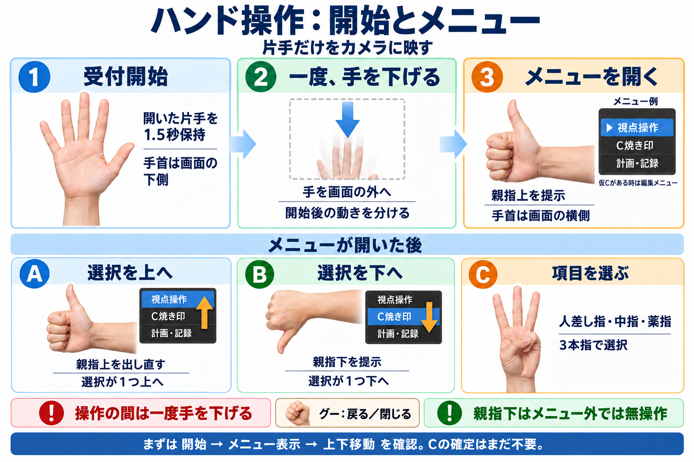
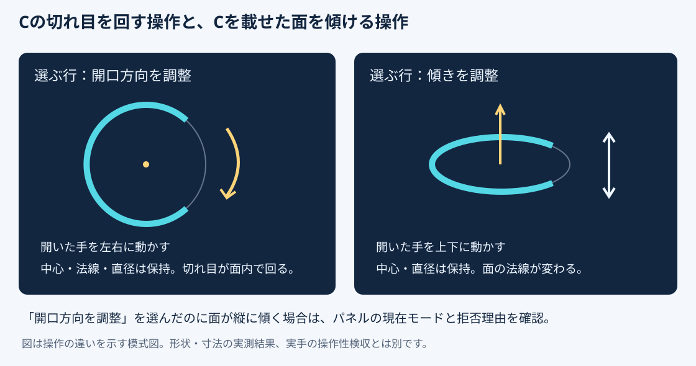

# 完成判定の検証計画（2026-10-12）

## 残件の実行シナリオ（2026-10-12作成）

ジェスチャーを提示する手順は[4枚のイラスト手順](テストシナリオ20261012/49_illustrated-gesture-test-scenarios.md)を使用する。①開始・視点、②C配置・方向・確定、③計画・記録、④戻る・取消・誤操作防止。図は説明用、回数・分岐・合格条件は本書を正本とする。

本人「各テストシナリオを作ってください」に対応。本節は既存計画の実行手順であり、別の要求正本を作らない。要求はdocs/03 FR-013・SR-003/007/008・IT-001〜005・AC個別表、docs/23 H-01〜12・X-01〜08、docs/33 V-01〜10、docs/38 W-06〜09。結果は[docs/48](48_completion-verification-results.md)へ記録する。**本節のシナリオは未実施。過去の部分PASSを今回の実施結果に転記しない。**

### 担当・実施順・準備

| 順番 | シナリオ | 操作する人 | 準備・記録する人 | 開始条件 |
|---|---|---|---|---|
| 1 | H-01〜03、V-01〜04・08〜10：基本操作 | 本人（実手） | 実装担当 | 本人が参加可能。隔離シーンとカメラ接続を準備済み |
| 2 | H-04〜12、V-05〜07：計画・訂正・精度・継続 | 本人（実手） | 実装担当 | 基本操作成立、計画用デモデータ・注入器を準備済み |
| 3 | F-01〜04：障害と代替操作 | 本人が手操作、試験担当が代替マウス操作 | 実装担当 | 同一初期状態の比較用シーン・試験台帳・復元手順 |
| 4 | D-01〜06：署名と配布 | 配布担当・試験担当 | 実装担当 | 正規署名者、隔離した配布試験環境。カメラ検収と独立に準備可能 |
| 5 | A-01〜03：権限・通信・保存先 | 監査担当・試験担当 | 実装担当 | 必要な監査権限と採取手段、署名済み候補 |
| 6 | R-01〜02：受入・通常復帰 | 実装担当と別の検収者 | 実装担当 | 前段の証拠が揃い、未解消所見を一覧化済み |

本人にログ取得・アプリ起動・ウィンドウを順番に最前面へ出す作業を依頼しない。実装担当がPixelと認識アプリの接続、対象Slicer、統合パネルを準備する。主操作は手のみ。サイズ設定、アプリ再起動、障害注入、代替マウス試験は役割を分けて介入を記録する。長い試験は区切って休憩できるが、指定600秒の途中停止は600秒達成と数えない。

共通準備：合成球体または登録済み非患者デモ、専用のイベント／計画台帳、直径5mm、受付停止・仮Cなしから開始。通常セッションの未保存状態と台帳は触らない。試験Slicer追加は同時1個まで。構成・カメラ・モデル・ソースhash・実行PID・保存先・試験前件数を記録する。最新候補は作成時点で`20261012-143600`だが、実施時に現物と版を再確認する。

各試験の共通終了：試験用の未確定Cの処置を明示し、受付停止、試験用接続／注入器を解除、台帳差分と対象モデルhashを採取。想定外の確定・取消・対象外操作が起きたらそのケースを停止しFAIL、前後証跡を保全する。本人の通常のCを片付け目的で取消さない。

### 手形と画面の共通手順

図は説明用であり試験成功の証拠ではない。実際の主メニューは「視点操作」「C焼き印」「既存Cの選択・訂正」「計画・記録」「操作を停止」。詳細は[操作ガイド](40_completion-operation-guide.md)。各H/Vの「選択」は下記の操作を意味する。

1. **開始**：開いた片手を1.5秒保持。「受付中」を確認し、手を1秒下げる。開始だけでは視点・Cが動かない。
2. **メニュー**：親指上を約0.5秒。「メニュー：開」と選択中の▶を確認する。閉状態の項目概要表示だけを「開いた」と判断しない。
3. **選択**：親指上で▶を上、親指下で下。目的行に合わせ、手を下げて3本指（人差し指・中指・薬指）を提示する。ILoveYouとは別。モードと開閉表示を確認する。
4. **配置**：照準モードで人差し指1本を表面へ向ける。有効照準を確認し、手を下げて2本指で仮配置。まだ保存されない。
5. **方向**：「開口方向を調整」では開いた手を左右、「傾きを調整」では上下。選んだモードの見出しと実Cを同時に確認する。
6. **確定**：「確定へ進む」→対象・仮C ID・版・5mm・方向を確認→手を下げて3本指。確認画面に入るだけでは保存されない。
7. **戻る**：メニュー内のグーで一段戻る。手を下げて再提示するたびに次の一段。「メニュー：閉」で止める。**閉状態で仮Cがある時に新しいグーを出すと取消になる**ので、戻り試験と取消試験を混ぜない。

離散操作間は通常1秒手を下げる。これは案内時間であり、保持／解除の実構成値（既定0.35秒）は試験ログに別記する。本人が確認した提示方向は、開いた手・グー・人差し指・V等では手首が画面下、親指上下では画面横。距離・傾き・左右などを変える試験はその条件を別記する。

### H：実手による機能シナリオ

各行を少なくとも1通し実施し、分岐は別ケースとして記録する。これでVの指定反復回数を代替しない。H-04以降に必要な作成者区分・理由・承認済み属性は、実装担当が準備した非臨床デモ専用値を使う。

| ID／目的 | 手順（左から順に実施） | 合格条件・残す証拠 |
|---|---|---|
| H-01 開始・視点・停止 | 停止→共通開始→視点操作で回転／パン／zoom→C照準→表面外→表面内→メニューから操作停止 | 受付とモード、照準無効／有効が判別できる。C・台帳増分0。本人が回転軸・感度とパン／zoomの操作性を評価。認識表示だけで合格にしない |
| H-02 C編集・取消・確定 | 仮配置して手形保持→位置移動（法線が異なる面・無効交点を含む）→開口回転→連続傾斜→反転→リセット→視点zoom→同じC編集へ復帰→取消。別ケースで配置直後に取消。さらに再配置→独立確定 | 仮Cは1件、保持で追加0。無効交点は移動0、zoomでC幾何不変。取消2ケースとも保存0、独立確定は1件。各編集のID・版・中心・法線・開口・寸法・モデルhashを比較 |
| H-03 3件と再起動復元 | 異なる位置・方向で3件確定→各点を選択しC再表示→保存先選択と保存→担当が停止・終了・再起動→本人が手で読込・レビュー | 独立ID3件と順序・完全形状・メタデータを再現。再表示／再読込で追記0。準備担当の再起動介入を明記。旧確定記録不変 |
| H-04 新規計画 | PLANNEDを選択→新規計画・作成者区分→少なくとも2予定を配置・編集・確定→別の仮Cを取消→保存。仮C中のレイヤー切替も試す | 予定・計画ID・版・区分・時刻・承認属性を保存。PERFORMED増分0。仮C取消は予定確定なし、仮C中レイヤー変更拒否 |
| H-05 計画改訂 | デモ承認済み計画選択→新版開始→予定追加→既存予定削除（独立確認）→別予定移動・方向変更→保存→旧版／新版比較 | 4種の差分と新版が存在。旧版hash不変、旧版編集不可。削除と未確定C取消を区別。比較表示自体は追記0 |
| H-06 予定追従 | 次予定選択→離れた位置・姿勢へ仮配置→予定ゴーストへ位置／方向調整→独立確定→レビュー | ゴースト1件、位置・方向等3種の差分が更新。実績1件へ予定IDと確定時差分を保存。予定・モデル不変、自動吸着・自動確定0 |
| H-07 順序とスキップ | 予定選択→順序変更→理由→明示実行。別対象を選択→スキップ理由→明示実行 | 追従順と次ゴーストが変わる。理由・時刻の監査記録を確認。PERFORMEDのC確定増分0、承認済み計画不変 |
| H-08 計画外 | 計画外を選択→理由→配置・編集→独立確定→予定／未実施／計画外の表示を比較 | 計画外実績が1件、理由・時刻あり。元計画不変。予定と実績を区別し、治療成功とは表示しない |
| H-09 撤回・訂正 | 確定点A選択→取消監査→理由→独立監査確認。点B選択→訂正→理由→新仮C編集→独立確定。別ケースで訂正用仮Cを取消 | 元A/Bは上書きせず、監査／訂正に元IDリンク。理由選択や確認画面だけで監査確定0。訂正取消ケースは訂正確定0 |
| H-10 喪失と明示再開 | 編集中に遮蔽・複数手・対象喪失をそれぞれ発生→安全条件復旧→手を再提示→必要なら受付開始と手下げ→「凍結した仮Cの編集を再開」→編集。各条件で凍結後取消も別に行う | 3条件×再開／取消の6ケース。凍結中ID・座標・方向・台帳保持、自然復帰0作用。明示再開後だけ編集、取消は保存0。対象外ウィンドウへ作用0 |
| H-11 保持と戻り | メニュー選択／理由選択の手形を次画面まで保持→継続保持→手下げ→独立確定。確認→C編集→主メニュー→閉、計画の5選択一覧→計画・記録→主メニュー→閉もグーで確認 | 保持が次画面の確定へ流れない。一段ずつ戻り、保持で多段戻り・取消・保存0。独立確定のみ予定した1件。5一覧は計画・保存版・作成者・保存先・予定項目 |
| H-12 保存失敗・結果照会 | 担当が隔離保存失敗を注入→本人が確定→未確定表示→担当が解除→本人が再確認して明示操作。別ケースで保存成功後の返信だけ遮断→復旧後、本人が結果照会→再起動後にも照会 | 保存失敗は同じ仮C維持・確定0。返信不明を成功と表示しない。照会は元イベントを返し、重複保存0。障害注入と手操作を別ログで対応づける |

### V：回数・方向・時間を指定するシナリオ

元仕様の10項目を維持する。Hとの同時実施は同じ試行IDと条件で対応づけられる場合のみ算入する。

| ID | 手順・回数 | 合格条件 |
|---|---|---|
| V-01 | view／開口方向rotate／傾きtiltで開始→保持→手下げ→再提示を各10回（30回） | 開始だけの区間はC・カメラ移動／保存0。再提示以降の意図した操作と区別 |
| V-02 | 有効／無効表面×仮Cなし／ありの4条件を各10回（40回）。1本指で照準、手下げ、2本指 | 有効かつ仮Cなしだけ1件配置。他は無作用＋理由。保持重複0 |
| V-03 | 「開口方向」見出しを確認→開いた手を左／右へ各10回（20回） | 切れ目だけ面内回転。中心・法線・寸法不変、tilt命令0。目視と幾何を照合 |
| V-04 | 傾き選択→上下調整→開口方向へ戻す、上／下各10回 | 見出しと作用一致。開口回転と傾きを取り違えない。中心・寸法保持 |
| V-05 | 試行表の元6形×左右×距離2×傾き2×各10＝480提示。補助の親指下80提示、遷移／不明形等240試行を別集計 | 明確形ごとの意図と実認識・発行・受理を記録。意図しない取消／確定／モード変更0、UNKNOWN無作用。誤認識・拒否も分母に残し、平均値で不合格を隠さない |
| V-06 | 手形保持、短い欠落、手を1秒下げた再提示を比較。各手形・対象操作を記録し、最低各10反復を本シナリオの追加条件とする | 保持／短欠落で重複0、解除後の新提示だけ1操作。人の動作時間は推定で断定せず実フレーム時刻から測定 |
| V-07 | 切断・接続置換・応答遅延／dropを各10回。別に通常の実手操作600秒、段階入力再生600秒を独立実施 | 通常時timeout0・未処理例外0。注入時は停止凍結、再接続だけで再開0。試験条件にないdrop0。停止待機600秒の旧PASSでは代用しない |
| V-08 | 正面／斜め／側面／遮蔽で方向図と実Cを比較。基準5mm、旧仕様の10mm、変更値7mmを試す（12組）。サイズ設定はマウス可、終了後5mmへ戻す | 指定寸法と保存幾何が一致。開口と面の向きが判別可能。表示切替だけでは幾何・台帳変更0。既存確定C不変。7mmは追加試験値、基準変更ではない |
| V-09 | 正常二段階確定、古い版、拒否、仮C取消、保存失敗を別ケース。古い版は担当の隔離遅延注入で作る | 独立確定前0、受理後1件。古い版／拒否／取消／保存失敗は0保存。拒否理由が表示される |
| V-10 | 同じSlicerで開始→照準→配置→開口回転→位置修正→確認→確定→停止。別通しで確認から戻って取消→停止 | 主操作は手だけ。サイズ以外のマウス介入なし。確定1件、取消0件。本人がモード・反応・拒否を画面から判断できる |

V-05は[既存試行表](../work/completion-audit-20261012/current-trial-matrix.json)を使用。距離2条件のcm・傾き2条件の度数、照明、左右、操作者匿名区分を**実施前に**記入する。未入力のまま実施・合格にしない。原文が未確定とする遅延・疲労等の閾値は測定値と本人評価を記録し、勝手な閾値で合格を作らない。条件・閾値未決は「判定保留」とする。

### F：4障害条件での代替マウス全操作（X-02）

**各行で下記共通列を最初から最後まで行う。** 既存Q08の「引継ぎ＋開口編集」だけの成功では完了にしない。

| ID | 障害を起こす方法・担当 | 復旧方法 |
|---|---|---|
| F-01 手受付無効 | 仮C編集中に担当が受付停止。認識アプリ／カメラ自体は接続維持 | 手受付は明示開始まで停止のまま |
| F-02 遮蔽 | 本人が手を隠す、または担当がカメラ視野を遮る。映像は保存しない | 遮蔽を除去し、認識復帰を確認するだけ。まだ操作再開しない |
| F-03 カメラ物理切断 | 担当が試験用Pixelの接続を物理的に外す。カメラエラーと停止を記録 | 再接続。再起動が必要なら担当が実施し時間を記録、勝手にARMしない |
| F-04 手通信切断 | 担当が試験用の認識器→Slicer接続を切断。Slicer本体を終了しない | 試験接続を再確立。旧セッションと新セッションを区別 |

1. 手で仮Cを配置し、位置・傾きを変更。最後の描画済みID／版／形状／カメラ／台帳を記録する。
2. 指定障害を発生させる。手入力停止・仮C凍結・理由表示・形状不変を確認する。
3. 「詳細マウス操作」→「マウス操作へ切替（手操作を失効）」で引き継ぐ。最後の仮Cが不意に変わらないことを確認する。
4. 担当が旧手要求を隔離経路へ遅れて提示し0作用を確認。新しい手要求もmouse所有中は編集できない。物理断後の再提示は、新しいTCP上への旧要求再提示と明記する。
5. 引き継いだ仮Cで表面ドラッグ→連続傾斜→開口回転→反転→リセット→確認画面→Noを実施。保存0・同一仮C保持を確認して明示取消する。
6. **同じ障害が継続した状態で**マウスによる新規配置→表面移動→連続傾斜→開口回転→独立確認Yes。1件保存を確認する。さらに新規配置→編集→取消を行い、この取消の増分0を確認する。
7. 障害を復旧してもmouse所有のままで手が動かないことを確認する。「ハンド操作へ戻す（開始待ち）」後は停止。明示開始→手下げ→必要な仮C再開を経て初めて編集できることを確認する。
8. 同じ初期状態の別シーンで、同じ目標位置・方向・5mm・操作列を実手で行い比較する。中心／方向／C全体／状態遷移／ログ種別と順序を照合する。独立ID・時刻・入力手段は対応表で比較し、差を消さない。幾何許容差は試験前に固定し、未決なら比較判定を保留する。

各障害で確定枝・取消枝・旧手要求拒否・復帰枝を個別判定する。共通安全条件の破損・対象不一致をマウスで回避できた場合はFAIL。代替手段の成功を、手だけの主操作成立の代わりにはしない。

### D：正規署名後の配布・更新・復旧（X-07/08）

実装担当は署名前の一覧・比較を準備する。正規署名は署名者、既存信頼での検証と実行は配布試験担当が行う。署名対象が未署名ならD-02以降の正規配布試験は「前提未成立」。署名拒否を迂回して先へ進まない。正常旧版と新版の両方を隔離環境に用意し、通常の未保存セッションを閉じて代用しない。

| ID | 手順 | 合格条件・証拠 |
|---|---|---|
| D-01 最終版と署名 | payload・依存・モデル・設定・外部実行物を固定→SBOM／manifest生成→外側activate/startとmanifest catalogを正規署名→既存信頼で検証→署名後の現物hash採取 | 対象漏れ0。全署名対象Valid、catalogが最終manifestに一致、payload／runtime／依存hash整合。署名後に署名済みcatalogの内容を生成し直さない。署名者・対象・時刻・fingerprintを記録 |
| D-02 一般ユーザー起動 | 全試験対象停止を確認→選択版を有効化→その版の署名済み起動entryで起動→Pixel接続・統合パネル・停止・5mm・保存先・ロード版を確認→基本操作と保存／再読込→停止終了 | 最小権限で成立。選択版＝検証版＝実ロード版。Slicer1個、認識器は正規の1起動組。接続しただけで自動ARM0。昇格要求で機能を補わない |
| D-03 計画停止更新 | 正常旧版起動→明示停止・試験データ保存・終了→新版へactivate→新版起動→版・保存先・既存記録再現を確認 | 停止時間内のみ更新、実ロード版が新版。既存記録・設定を失わない。起動に使われたentryとmanifestを採取 |
| D-04 更新拒否・競合 | 受付中／停止中でもプロセス生存／相対app.pyだけ生存／別ルート入力プロセス生存／二重起動／更新と起動の同時実行を各別ケースで試す | 不適切な更新・追加起動を拒否。排他により競合二者が同時成功しない。拒否時の正常pointer・台帳・既存プロセス不変。predicate単体試験ではなく署名entry実行結果を記録 |
| D-05 異常配布と途中失敗 | 隔離コピーでcatalog改変、payload改変、依存不一致、構成不一致を各注入。別ケースで更新途中終了、Slicer成功後に認識器だけ起動失敗を注入 | 不適合版を起動／成功表示しない。以前の正常pointerを保持または正規手順で復元。部分起動の残存とログを確認。改変・停止は試験用コピー／試験PIDだけ |
| D-06 rollback | 正常新版を停止・終了→既存正規rollback手順で旧版選択→旧版起動→版・設定・保存済みデモ記録を照合→停止 | 旧版の信頼と実物を再検証し実ロードを確認。新版が残って二重起動しない。非互換記録を黙って変換せず、復元不能ならFAILまたは前提不適合と明記 |

実行コマンドは実施担当が実物の引数仕様に合わせ記録する。現在の入口は`activate_completion_release.ps1`（Manifest／ReleaseRoot／Rollback）と`start_completion_release.ps1`（ReleaseRoot／SlicerExecutable／WorkspaceRoot／CameraIndex）。この計画作成だけで実行・署名・環境変更を行ったとはしない。

### A：一般ユーザー・通信・保存先の監査

| ID／担当 | 手順 | 合格条件・不足時の扱い |
|---|---|---|
| A-01 最小権限／試験担当 | 署名版の実Slicer・認識launcher・実認識器のトークンを確認→非昇格のままH相当の基本操作・計画・保存／読込・停止を実行→作成ファイルの権限確認 | 常用昇格なしで必要機能成立。証拠はトークンと実操作結果。トークン非昇格の観測だけで全機能PASSとしない |
| A-02 通信／監査権限のある担当 | 対象PIDと子プロセスを特定→プロセス起動前から停止後まで接続／通信監査→起動、待機、実手操作、計画保存読込、切断復帰、終了の各区間を対応づける | 実通信先・方向・時刻・PID・採取範囲・欠落を記録。loopbackと外向きを区別。禁止データ送信0。短時間接続を捕捉できない間欠採取や、送信内容を判断できない暗号通信は「完全監査PASS」にしない。無関係プロセスや映像本文は採取しない |
| A-03 保存先／監査権限のある担当 | 使い捨て環境で書込イベント監査を開始→A-02と同じ列＋保存失敗・終了を実行→台帳・ログ・一時領域・crash出力・ユーザー領域の実書込先と内容種別を照合 | 許可した非映像メタデータとデモC台帳のみ。カメラフレーム・顔・音声・患者データの保存0。ソース検索や指定フォルダの差分だけでは完全監査にならない。採取不能区間は未検証として残す |

監査は合成／非患者デモで実施する。監査ツール導入・権限変更が必要なら対象担当が正規手続で準備し、取得できないログを「問題なし」としない。A-02は短時間通信の見逃し、A-03は未監視保存先の見逃しをそれぞれ報告する。

### R：独立受入と終了状態

| ID | 手順 | 合格条件 |
|---|---|---|
| R-01 独立受入 | 実装担当と別の検収者が対象版を特定→98要求IDとH/V/X/F/D/Aの証拠対応を確認→実画面・保存記録・失敗履歴を確認→所見一覧→修正対象の再検査→署名付きまたは担当名・日付付きの受入判断 | 必須ケースに未実施・FAIL・根拠なしが残らない。AI作成試験と本人実手結果を区別。未合意性能基準は保留で、全体適合へ繰り上げない。別AIの文書照合だけで人の独立受入としない |
| R-02 通常環境へ戻す | 通常シーンの保護対象を直前確認→試験Slicer・認識器・注入器・監査採取を終了→必要な通常接続を復帰→統合パネルと内部状態を照合→通常台帳と視点の前後hash確認 | 通常Slicer1個、認識接続、受付停止、仮Cは開始前の保護条件どおり、次回直径5mm。通常データに試験記録混入0。実行PID・ロード版・保存先・終了した試験PIDを記録 |

### 1ケースごとの結果記入欄

次の様式をdocs/48へケース単位で追加する。同じシナリオを再実施した場合は試行IDを変え、先行失敗を残す。D/A/Rの結果欄も実物の証拠取得後に記入する。

| 項目 | 記入内容 |
|---|---|
| シナリオ／枝／試行ID | 例：F-03／確定枝／試行01 |
| 実施日時・担当・操作者匿名区分 | 未実施時は空欄 |
| 版と実環境 | manifest/runtime/model/config hash、ロード版、PID、接続、保存先 |
| 前提と条件 | 初期状態・件数・対象hash、手の左右／距離cm／傾き度／照明、事前固定許容差 |
| 実施した操作 | 実手／実マウス／直接TCP／合成入力／障害注入を区別。介入・途中停止も記載 |
| 観測 | 画面表示、認識→受付→要求→受理→描画／保存時刻、req／draft IDと版／event ID、前後差分 |
| 期待値と実測値 | 成功数／試行数、誤操作数／観測時間、復旧時間、台帳増分、保存形状比較、本人の操作性評価 |
| 証拠 | 非映像JSON/JSONL・監査ログ・非患者UI観測メモのパス。カメラ画像は保存しない |
| 判定 | PASS／FAIL／未実施／判定保留。部分成立なら成立した枝だけを明記 |
| 未達時 | 原因・影響・担当・修正先W・再検査条件。予定を結果として書かない |

H12＋V10＋F4＋D6＋A3＋R2＝37シナリオ。下位分岐・反復は別試行であり37回だけの試験ではない。V-05の480＋80＋240＝800試行も、H/V全項目や長時間試験の代わりにはならない。

## 完成指示後の追加検査

docs/38 Q01〜08を本計画のK03〜08へ接続する。本人の実手参加は「後で参加する」のため保留。元のH12/V10・480試行を減らさず、親指下80試行と遷移／不明形等240試行を補助条件として準備し、合成成功を記入しない。

- K03/06：5選択画面のFISTで一段戻る処理を、自己回帰と実Qt表示で確認。初期画面の直接セットはsetupとして区別し、戻りはOperationController.updateを通す。保持中の重複、取消／保存0、台帳不変を検査する。
- K06：実マウスの表面ドラッグ・方向／傾斜スライダー・反転・リセット・wheel・確定／取消と、分類後の合成手入力による同列を比較。幾何、描画ACK、カメラ、寸法、台帳増分を記録。カメラ推論、実手、4喪失条件の検収を含めない。
- K06/Q08：別試験で明示disarmと実TCP socket切断を作り、停止凍結→実UIによるmouse引継ぎ→開口編集→hand返却を確認。遅着旧手要求とmouse所有中の新手要求は0作用、返却後の自然再開0、明示armだけでは凍結を解除しない。原文X-02の4条件×全操作列のうち一部であると明記する。
- K04：隔離TCPで特定の編集要求を捕捉し、Qt timer経由で遅らせる。確認保持中の到着、および新しいseq先着後の古いseq到着を別々に作る。古い確認では0保存、解放・新版の再確認後だけ1保存。診断器の失敗も保全し、製品失敗と混同しない。
- K05：修正版の通常Pixel認識とSlicer接続を600秒、映像なしで観測。fresh・connected・停止状態・dropを照合する。
- K07：相対app.py起動の見落としを、同一CIM観測の旧／新版predicateで確認し修正。停止・起動判定の意味的試験、PowerShell構文、署名ゲート保持、最終SBOMと候補実物の一致を確認。未署名候補を起動しない。
- K08：通常台帳4本・カメラ・5mm・保存先・runtime一致を実Slicerの読取probeで確認。試験プロセスだけ終了する。署名、完全な通信／保存先監査、実手、独立受入は未成立のまま残す。

本人依頼「検証計画書MDを作って、検証してください」による。要件正本はdocs/03（FR-013、SR-003/007/008）、docs/23、docs/33、実装計画はdocs/38。今回の基準寸法は本人最新指定の直径5mm。結果はdocs/48へ記録し、実装報告docs/39・PROJECT_STATUSへ接続する。

## 判定と実施条件

PASS／FAIL／未実施を区別する。既存結果は参考証跡として扱い、今回再実行した結果と混ぜない。自己作成の試験は、実Slicer/TCPを使っても自己検証であり、実手や独立検収の代用にしない。カメラ・患者画像は保存しない。通常台帳に試験記録を追記しない。保存・障害試験は人工球体と隔離台帳を使う。試験Slicerは1個まで追加し、終了時に閉じて通常Slicer1個へ戻す。

## 試験項目

| ID | 要求・対象 | 方法と合格条件 |
|---|---|---|
| K01 | 5mm基準、変更可能 | 新しい実Slicerプロセスで初期直径5mm、生成点の中心からの距離2.5mmを確認。寸法変更・既存C保持の既存回帰を実行 |
| K02 | W-09 台帳選択維持 | 起動時の保存先と通常セッションの選択先を照合。新台帳へ自動復帰しなければFAIL。試験中に旧原本を修正しない |
| K03 | W-04〜06、SR-003/007/008 | 認識・Slicer・toolsの既存回帰を再実行。失敗0。実カメラの認識精度とは区別 |
| K04 | W-05 保存・計画・監査 | 隔離実Slicer/TCPで配置→開口→傾き→確定、古い表示拒否、計画版、監査、障害・整合性・対象変更の既存suiteを実行。各JSONと終了コードが成功 |
| K05 | W-04・07 通常接続 | 初回は通常Pixel認識とSlicerの共有状態を60秒読取。その結果を保持し、修正反映後のQ06で600秒の追加観測を実施する。いずれも全数fresh・connected、停止維持、通信drop増加0を照合。停止接続の600秒成功を実手連続操作の600秒合格にはしない |
| K06 | W-06/07 実手・代替マウス | H-01〜12/V-01〜10と同列操作比較。V-05の480明確形＋不明形、各600秒、本人の操作性評価を省略しない。本人の実手提示が得られなければ未実施 |
| K07 | W-08 署名・配布 | 正規署名、選択版起動、更新・rollback、一般ユーザー・通信監査の証拠を照合。未署名の自己試験を署名後配布のPASSにしない |
| K08 | W-09 終了状態・独立検収 | 試験プロセス終了、通常Slicer1個、通常台帳hash不変、認識再接続・停止を確認。独立した検収は別担当の実施証跡がなければ未実施 |

## 実行と記録

既存pytest、tools/run_completion_fixture.ps1のsuite、tools/observe_normal_connection.pyを使用する。追加寸法probeは実Slicerのオブジェクトと幾何点を直接読む。実行版hash・試験ディレクトリ・件数・失敗理由をdocs/48に保存。既知の永続化不足を検証中に隠して修正済み扱いしない。FAILまたは未実施がある場合は全体完成未達とする。
