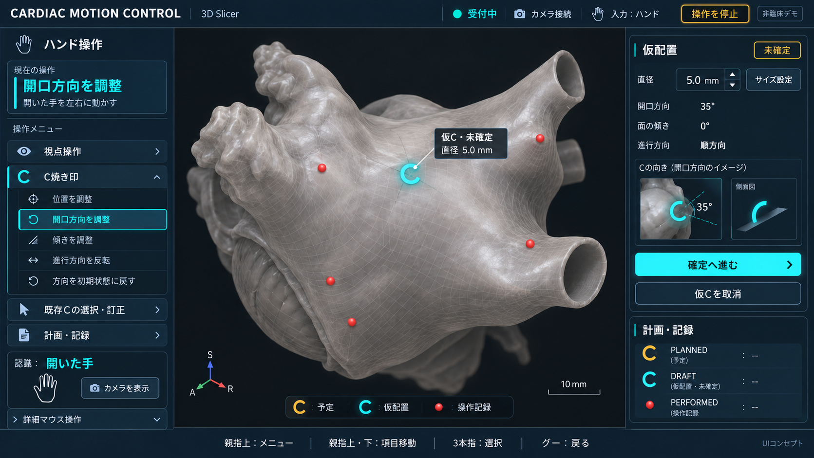

# 医療技術を感じる統合UI・画面コンセプト

2026-10-12。本人「UIに洗練された医療技術が感じる画面イメージを作ってください」に対応。



濃紺とシアン、中央の大きな合成3Dモデル、左の操作メニュー、右の実寸・方向・確定導線を一画面にまとめたデザイン案。受付・接続・入力所有権と操作停止を常時表示。カメラ表示は同一画面内の任意表示。基準直径5mmを数値欄で変更できる構成。予定／仮配置／操作記録を色だけでなく形・ラベルでも区別する。

参照：../40_completion-operation-guide.md、../47_completion-verification-plan.md。現行要件を踏まえた見た目の提案であり、常設ナビゲーションやレイアウトの採用・実装は未実施。実患者データ・実Slicerの画面証跡ではなく生成した合成イメージ。角度等の数値は模式例。画像内の縮尺は実寸検証の証拠にはしない。

組込image_genとimagegenスキルで生成・編集。停止ボタン、DRAFT/PERFORMED凡例、指示の誤ったアイコン、解剖ラベルを修正し、最終画像を保存した。

## 初期生成プロンプト

```text
Use case: ui-mockup. Create ONE premium high-fidelity desktop application SCREEN IMAGE for the existing Cardiac CT Motion Control / 3D Slicer hand-gesture prototype. Flat front-on screenshot, no laptop/room/mockup frame. Wide 16:9 composition, high resolution, crisp Japanese typography. The user wants refined advanced medical technology, with superb practical readability, NOT sci-fi holograms.
Style: charcoal/navy precision workstation, restrained teal/cyan accent, warm pearl-gray 3D anatomy, generous spacing, finely aligned 1px borders, subtle corner radius, sophisticated clear hierarchy, calm technical polish. Large enough labels, high contrast. No gratuitous graphs or shiny glass effects. All camera/gesture/model controls integrated into ONE application window; no overlapping floating windows or modal blocking model.
Product label top left 「CARDIAC MOTION CONTROL」 and small 「3D Slicer」. Top right small outlined chip 「非臨床デモ」. Top status strip large teal-dot 「受付中」, 「カメラ接続」, 「入力：ハンド」, plus easily found outlined 「操作を停止」. These are a conceptual active-editing state, not certification.
Screen layout: integrated slim left control rail about20%, dominant central3Dviewport about62%, restrained right information column about18%. Center occupiesmostspace with beautifully rendered SYNTHETIC NONPATIENT left-atrial/heart-surface model, pearlmatte mesh with faintwireframe details, several tiny RED committedpointmarkers, a small CYAN OPEN-C uncommitteddraft placedonvisibleanatomicalsurface. No actualpatientdata, CTimages, ECG, livephysiologicmeasurements, diagnosis, treatmentscores, AIautomaticablation, devicesafetyclaims. CentralC notgiantfloating outsideheart. One fine callout near draft 「仮C・未確定」 with 「直径 5.0 mm」. Colorlegend bottomofviewport 「予定」「仮配置」「操作記録」 withdistinctsymbols. Small R/A/S axiswidget cornerand10mm scale. Soft depth cues, modellegible againstneardarkviewport. No purpleboundingbox.
Left header 「ハンド操作」 with icon. Small state card 「現在の操作」 then prominent 「開口方向を調整」 cyanaccent, explanatoryshort 「開いた手を左右に動かす」. Below an integrated navigationgroup 「操作メニュー」 with crisp simpleicons and EXACT visible items 「視点操作」「C焼き印」「既存Cの選択・訂正」「計画・記録」. C焼き印 expanded into 「位置を調整」「開口方向を調整」「傾きを調整」「進行方向を反転」「方向を初期状態に戻す」; active open-direction row cyanborderandactivechip, no misleadingcheckboxes orirrelevanttreatmentcontrols. Menu may be visible as pinned navigation, but do not display 「メニュー：開」 or extra selectorarrow implyingstepfulgesturecommands. Nearbottom left compact 「認識：開いた手」 with simplehandoutline and a lowkey button 「カメラを表示」 (camera preview optional; NOT separatewindow and not dominatingworkspace). Underneath 「詳細マウス操作」 as collapsedtabforfallback.
Right inspector card title 「仮配置」, amber outlinedpill 「未確定」. Values 「直径 5.0 mm」「開口方向 35°」「面の傾き 0°」「進行方向 順方向」. Include small Cgaporientationdiagram and one 5.0mm numericfieldwithup/down control and 「サイズ設定」 button, makes sizechange visiblyavailablewithoutgesture. Below primary readable button 「確定へ進む」 (opens separate confirmation stage, NOT immediate save), secondaryquietbutton 「仮Cを取消」. Below small card 「計画・記録」 with 「PLANNED」「PERFORMED」 labelsandlittlelegend, no fakecounts orsuccessscores.
Bottom integratedstrip 「親指上：メニュー   親指上下：項目移動   3本指：選択   グー：戻る」 with restrainedaccurateicons ifspace; threefingers=index/middle/ring, noILoveYou. Tinybottomright 「UIコンセプト」 so nobody mistakesitforactualimplemented screen. Japanese exactstringsmustbelegible, no scrambleddenseparagraphs. No personnames/hospitalbrands/patientIDs/dateofbirth. No ECGstrip, no decorativepseudo-machinecharts. The screen should feel like elegant credible next-generation medical 3Dsoftware, serious, focused, quiet, usable.
```

## 修正プロンプト

```text
Edit this UI concept carefully, preserve the sophisticated navy/cyan visual design and leftcontrol/central3D/rightinspector layout, all main values5.0mm35deg0deg. Only corrections:
1 Add a clearly visible outlined amber 「操作を停止」 button to TOP RIGHT status bar; keep small 「非臨床デモ」 chip somewhere on top without overlapping. Stop must remain easytosee whileediting.
2 Right bottom「計画・記録」 cardcurrentlyincorrectlyshows cyanC asPERFORMED/実施の焼き印. Replace entirelegendcontent with EXACT THREE ROWS: AMBER outlineC 「PLANNED」「予定」; CYAN openC 「DRAFT」「仮配置・未確定」; REDdot 「PERFORMED」「操作記録」. NO「実施の焼き印」 or treatmentclaims. Bottomviewportlegend alreadycorrect keep.
3 Bottomgesturestrip currenticons incorrectlyshow index for thumbdown andopenpalm for3fingers. Remove ALL gesturehandicons frombottomstrip, use elegant textonly EXACT 「親指上：メニュー  ｜  親指上・下：項目移動  ｜  3本指：選択  ｜  グー：戻る」. Keep small UIコンセプト.
4 Remove anatomy callout text 「左心耳」「左上肺静脈」「左下肺静脈」「僧帽弁輪」「左心房」 fromviewport (thisis syntheticconcept model, notvalidatedanatomicaldiagram). Keep draftC5mmcallout, axis,scale.
Do not change entireinterface or add elements. No actualpatientdata. This is imageonlyconcept, notimplemented or certified.
```

最終採用元：C:/Users/HOMEA/.codex/generated_images/01a12073-ab9e-7bb0-84f3-a42f422e5752/exec-6964517a-ae14-4b06-83a0-c37f028090e6.png。初期版は採用していない。

