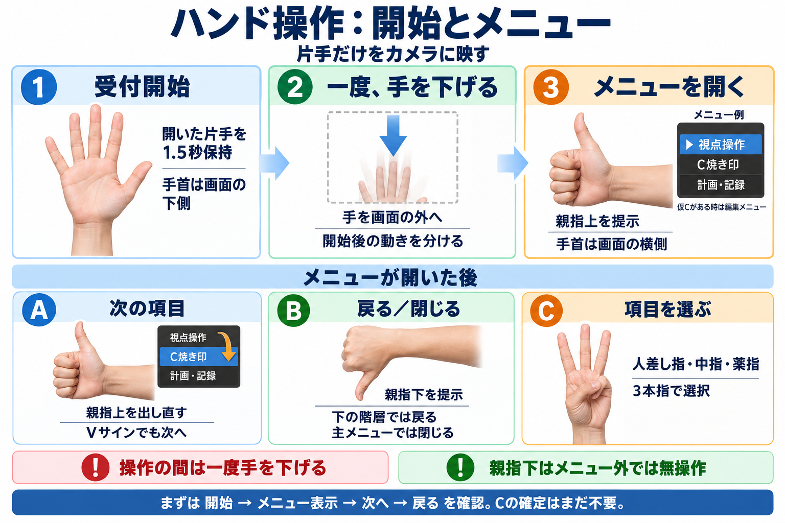

# ハンドメニュー操作図・生成記録

2026-10-12。組込みimage_genで生成。現行操作制御と本人が確認した手首の向きを反映。画像は目視で手形・向き・日本語・操作順を確認。実画面のスクリーンショットではなく、メニューは説明用の例。操作成立の試験証拠ではない。

## 最終プロンプト

Create a polished Japanese instructional infographic, landscape 3:2, very high legibility, white background, navy heading, softly colored blue/green/orange panels, realistic clean drawn hands, correct anatomy. This is a practical current hand-control guide for 3D Slicer, not a conceptual ad. Title 「ハンド操作：開始とメニュー」. Subtitle 「片手だけをカメラに映す」.
Layout: top row three numbered sequential cards (1,2,3). Bottom row three separate operation reference cards (A,B,C), clearly separated from startup sequence.
Top:
1 「受付開始」 Draw one fully open palm, all five fingers extended, fingers upwards and wrist entering from bottom. Text 「開いた片手を1.5秒保持」「手首は画面の下側」.
2 「一度、手を下げる」 Draw hand moving down and OUT of a small camera frame; downward arrow. Text 「手を画面の外へ」「開始後の動きを分ける」.
3 「メニューを開く」 Draw thumbs-up hand with other four fingers folded, thumb pointing screen UP, forearm/wrist entering horizontally from RIGHT side. Do NOT draw wrist entering bottom on thumb cards. Text 「親指上を提示」「手首は画面の横側」. Beside hand a tiny simplified dark menu UI labelled 「メニュー例」 with rows 「▶ 視点操作」「C焼き印」「計画・記録」. Small explanatory text 「仮Cがある時は編集メニュー」.
Bottom reference band heading 「メニューが開いた後」.
A 「次の項目」 thumb-up same horizontal forearm from right, arrow from one highlighted menu row to the next. Text 「親指上を出し直す」「Vサインでも次へ」. Do not imply holding triggers repeated next.
B 「戻る／閉じる」 thumbs-DOWN, wrist entering horizontally from RIGHT and thumb pointing screen DOWN, other four fingers curled. Text 「親指下を提示」「下の階層では戻る」「主メニューでは閉じる」.
C 「項目を選ぶ」 show THREE extended fingers INDEX + MIDDLE + RING, thumb and pinky folded. Absolutely NOT ILoveYou (index pinky thumb), not thumb-index-middle. Wrist entering bottom fingers pointing up. Text 「人差し指・中指・薬指」「3本指で選択」.
Bottom clear notes: 「操作の間は一度手を下げる」 and 「親指下はメニュー外では無操作」. Final thin blue strip 「まずは 開始 → メニュー表示 → 次へ → 戻る を確認。Cの確定はまだ不要。」
No clinical imagery, no patient images, no screenshot claiming actual UI, no extraneous controls. Japanese text exactly as provided, clear generous spacing. All thumb orientations are visibly vertical thumbs on horizontal wrists. Illustrate the hand gesture poses prominently.
