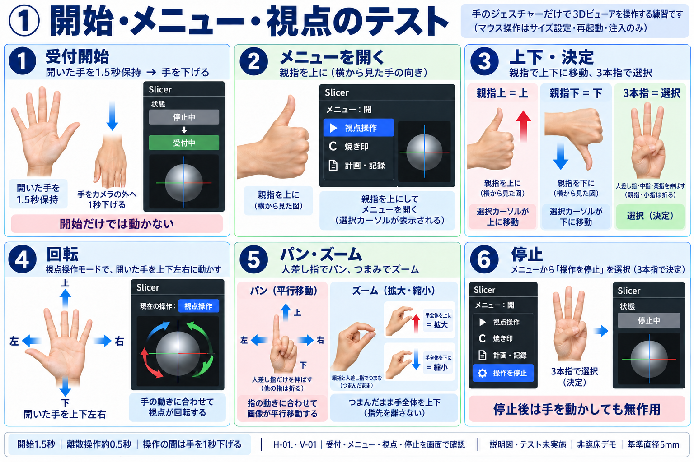
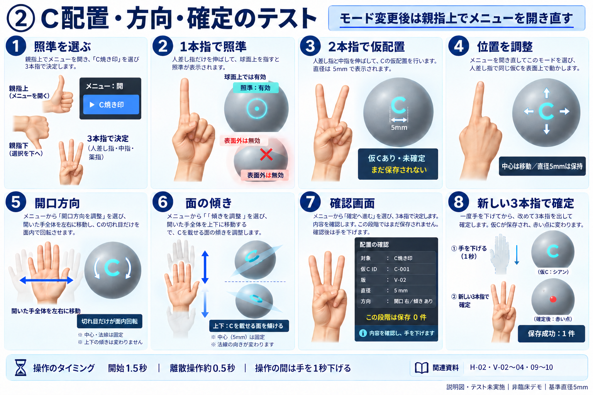
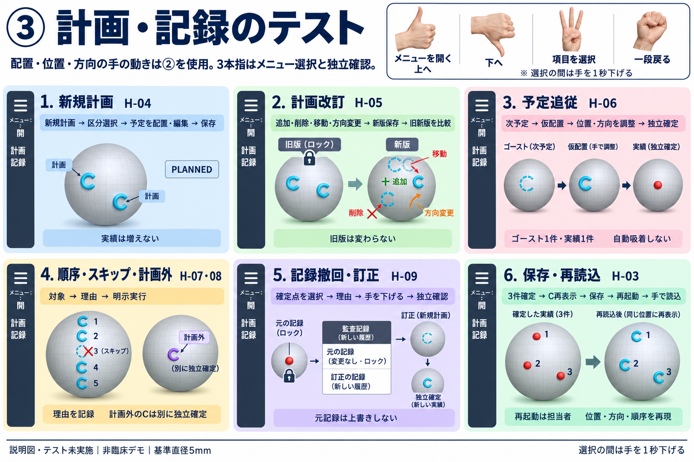
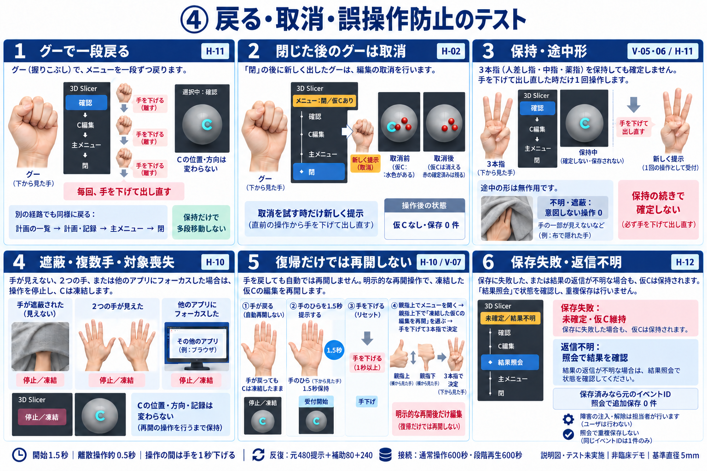

# ジェスチャーテストのイラスト手順

2026-10-12。本人「ジャスチャーのテストシナリオをイラストにして」に対応。実施手順・回数・合格条件の正本は[検証計画docs/47](../47_completion-verification-plan.md)。本書はその画面・手形の説明図。**テスト未実施、実画面の証跡ではない。** 最終採用した4枚を掲載する。

まず①で受付・メニュー・視点を確認し、②でCを仮配置して方向・確定を確認する。③は計画・記録の工程、④は戻る・取消・保持・喪失復帰を確認する。障害注入、アプリ起動／再起動、ログ取得は担当が行う。

| 図 | 確認する内容 | 計画との対応 |
|---|---|---|
| ① | 開始だけでは動かない／親指上で開く／親指上下で選択／3本指で決定／視点／停止 | H-01、V-01、メニューの共通操作 |
| ② | 1本指照準→2本指仮配置／位置／開口方向／傾き／独立確定 | H-02、V-02〜04・09・10。反転／リセット・取消枝はdocs/47の同ケースで別途確認 |
| ③ | 新規計画・改訂・予定追従・スキップ・計画外・監査・保存読込 | H-03〜09。手の配置・方向動作は②を使用 |
| ④ | 一段戻る／閉状態の取消／保持重複防止／遮蔽・複数手・対象喪失／明示再開／保存失敗と結果照会 | H-10〜12、V-05〜07。反復条件はdocs/47と既存試行表 |

## ① 開始・メニュー・視点

受付開始は開いた片手1.5秒、その後手をカメラの外へ1秒下げる。親指上で「メニュー：開」を確認し、▶を親指上／下で動かす。3本指は人差し指・中指・薬指。パンは人差し指、ズームはつまんだまま手全体を上下に移動する。

## ② C配置・方向・確定

照準は1本指、仮配置は2本指。位置調整で中心は移動する。開口方向は開いた手全体を左右へ移動し、Cの切れ目だけを面内回転させる。傾きは開いた手全体を上下へ移動する。手首をひねる動作とは区別する。確認画面を開くだけでは保存0件、手を下げた後の新しい3本指による独立確定で1件。

基準直径5mm。図のID・版・モデル・メニュー項目は模式例。実際は対象シーンのID・版とパネル表示を確認する。メニューの抜粋を全項目一覧として扱わない。

## ③ 計画・記録

③は工程の概要図。親指上下と3本指でメニュー項目を選び、配置・位置・方向の実操作は②を使用する。作成者・理由などの登録値は担当がデモ用に準備する。計画の版、予定と実績、元記録と新しい監査記録を別々に確認する。再起動は担当、読込選択は手で行う。

## ④ 戻る・取消・誤操作防止

グーはメニュー内で一段戻る。各段階で手を下げて再提示し、「メニュー：閉」で戻り試験を止める。**閉状態で仮Cがある時、新しいグーは取消になる。** 取消枝は別試行として記録する。

認識が復帰しただけでは編集しない。受付停止時は明示開始→手下げ→「凍結した仮Cの編集を再開」を選択する。保存失敗は仮C維持、返信不明は結果照会で確認。照会は追加保存しない。

## 生成と検証範囲

組込image_genで生成・編集し、手形・方向・状態・保存件数の説明を目視照合した。初期生成で選択名・手形・位置不変の説明に誤りがあった版は採用していない。最終4枚だけを本書とdocs/47から参照する。実手認識・実Slicer操作の合格をこの目視確認から導かない。

生成・編集プロンプトと最終採用元は[生成記録](gesture-test-scenarios-2026-10-12.prompt.md)。既存の実行結果はdocs/48、今回の図作成に伴うテスト結果の追加はない。
